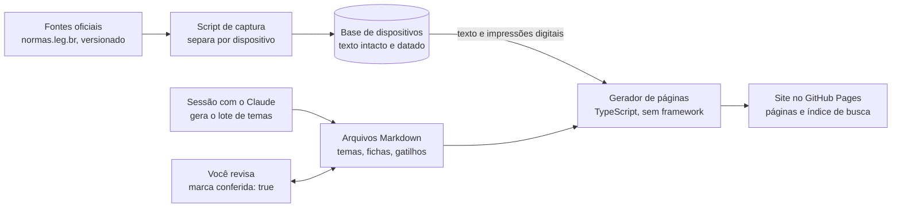

# Reforma Tributária Dissecada — documento de design

31/10/2026 · Fabrício Cardim · cópia do documento de design no Claude; esta versão no repositório é a de referência a partir de agora.

## Contexto e problema

Vamos construir uma aplicação web estática, separada da extensão Mentor Web, para dissecar a reforma tributária sobre o consumo. Ela é para o estudo de Auditor Fiscal da Secretaria da Fazenda da Bahia (banca Cesgranrio, edital não publicado), e é um site aberto a outros concurseiros.

A lei seca é difícil de ler por três motivos, em ordem de peso:

1. **Remissões**: "observado o disposto no art. 12, § 3º, II" sem o texto citado à vista, dentro da mesma lei e para outras normas.
2. **Finalidade**: as palavras são compreensíveis, mas não se sabe para que serve o dispositivo.
3. **Estrutura**: não se enxerga o que é regra geral, exceção e exceção da exceção.

A reforma agrava os três. A Lei Complementar 214/2025 tem 544 artigos e mais de vinte anexos, já foi alterada pela Lei Complementar 227/2026 e tem produção de efeitos escalonada por dispositivo, de 2026 a 2033.

A primeira ideia era encaixar a solução na extensão, acionada pela questão errada no TEC. Ela foi descartada em favor de uma aplicação própria, organizada por tema.

## Escopo

A aplicação cobre 13 temas da reforma, cada um com "antes e depois" e com a sua posição na transição de 2026 a 2033.

**Fontes legais carregadas, com texto integral:**

- Lei Complementar 214/2025, compilada com as alterações da Lei Complementar 227/2026.
- Constituição Federal compilada, nos dispositivos alterados pela Emenda Constitucional 132/2023, e os artigos próprios da emenda que não entraram na Constituição (regras de transição).

**Temas e profundidade:**

| Lote | Tema | Profundidade |
| --- | --- | --- |
| 1 | Fato gerador | completa |
| 1 | Não incidência e imunidades | completa |
| 1 | Sujeito passivo e responsabilidade | completa |
| 1 | Local da operação (destino) | completa |
| 1 | Base de cálculo | completa |
| 2 | Alíquotas e alíquota de referência | completa |
| 2 | Não cumulatividade e créditos | completa |
| 2 | Recolhimento e divisão do pagamento | completa |
| 3 | Regimes diferenciados | completa, anexos só como estrutura |
| 3 | Regimes específicos | panorama |
| 3 | Imposto Seletivo | completa |
| 4 | Transição de 2026 a 2033 | completa |
| 4 | Comitê Gestor e fiscalização | completa |

**Panorama** significa saber que o regime existe, por que existe e alguns exemplos, com link para os artigos. As provas do TEC ainda não cobram os regimes específicos em detalhe.

**Anexos:** entram só como estrutura: número, título, redução aplicada, artigo que remete a ele e as categorias listadas, com etiqueta de redação. Não entram as linhas de código de mercadoria; para elas há link para o anexo completo.

**Lado "antes":** é um resumo curto por tema, com citação exata e link para o dispositivo antigo no Planalto (Lei Complementar 87/1996, Lei Complementar 116/2003, leis das contribuições federais, redação antiga do artigo 155 da Constituição). O texto antigo não é carregado.

**Fora do escopo:** impacto econômico por setor, regulamentos e atos do Comitê Gestor, convênios, leis estaduais, integração com a extensão e com o TEC, questões geradas por inteligência artificial.

## Princípios invioláveis

Errar a letra da lei custa a questão, então tudo o que é lei vem da fonte e tudo o que é interpretação aparece como interpretação.

1. **Texto oficial intacto.** O texto legal vem só da captura compilada, sem nenhuma edição. Cada ficha mostra a data da captura e o link para a fonte.
2. **Tempo visível no dispositivo.** Todo dispositivo alterado mostra a etiqueta "redação dada por" e a data de produção de efeitos. Decisões do Supremo Tribunal Federal que alteram o texto também aparecem como etiqueta. A fonte registra a data da alteração, não a de efeitos; a data de efeitos vem do art. 544 da Lei Complementar 214/2025.
3. **Remissões determinísticas.** O gerador resolve as remissões absolutas e as relativas ("desta Lei Complementar", "deste artigo", "do caput") e expande um nível; o resto vira link. Uma referência vaga ("nos termos do regulamento") aparece como "não resolvida". A inteligência artificial nunca adivinha o alvo.
4. **Inteligência artificial separada e conferida.** O texto gerado fica numa caixa visualmente distinta, com o rótulo "não é texto de lei". Cada ficha nasce `conferida: false` e mostra esse aviso até ser revisada. No site aberto, a ficha não conferida é publicada para todos, com o aviso no topo da ficha e uma etiqueta nos resultados da busca e no índice do tema.
5. **Impressão digital do texto.** Cada explicação guarda a impressão digital do texto legal que explicou. Se a redação mudar, a ficha volta a `conferida: false`.
6. **Lacunas honestas.** Um dado que falta aparece como falta ("não carregada", "não resolvida"), nunca preenchido com um valor plausível.

### No site aberto

O rodapé de toda página traz:

- "Não substitui o texto oficial", com link para a fonte do dispositivo.
- A atribuição exigida pela licença Creative Commons do normas.leg.br.
- A indicação de que as explicações são geradas por inteligência artificial, com a situação e a data da conferência.
- A licença do conteúdo próprio do site: Creative Commons com atribuição.

O site não coleta dados pessoais além do e-mail opcional no formulário de problema, e não usa ferramenta de análise de acesso.

## Páginas

A unidade principal é o **tema**; a **ficha de artigo** é a página de detalhe para a leitura seca. Todas as páginas funcionam na largura de um celular.

| Página | Endereço | O que mostra |
| --- | --- | --- |
| Inicial | `/` | Os 13 temas por lote, a linha do tempo resumida e o link para "o que mudou" |
| Tema | `/tema/<nome>/` | O que é; regra geral e exceções; antes e depois; posição na transição; os artigos que compõem o tema |
| Ficha de artigo | `/lei/<lei>/art-<n>/` | Os quatro blocos do mockup, mais termos definidos e linha do tempo |
| Índice da lei | `/lei/<lei>/` | Livro › Título › Capítulo › artigo, com os anexos como estrutura |
| Linha do tempo | `/transicao/` | O que vale em cada ano, de 2026 a 2033 |
| O que mudou | `/mudancas/` | Fichas que voltaram a não conferidas desde a última captura |
| Busca | em todas | Busca por texto no navegador, sobre um índice gerado na compilação |

Os endereços são previsíveis (lei e artigo), para que a extensão possa um dia montar um link "abrir na lei" sem consulta.

**Ficha de artigo, de cima para baixo:**

1. **Onde estou**: a trilha na lei, a regra geral do trecho, onde estão as exceções e a navegação para o artigo anterior e o próximo.
2. **Texto oficial**: o dispositivo intacto, com remissões expandidas em um nível, termos definidos, etiquetas de redação, de efeitos e de decisão do Supremo Tribunal Federal.
3. **Para que serve**: o que é, para que serve e como funciona, gerado por inteligência artificial, em caixa separada, com a situação da conferência e o botão "Reportar problema".
4. **Onde a banca pega**: as palavras-gatilho da lista fixa encontradas no dispositivo, cada uma com a sua nota.

Na lateral fica a linha do tempo do dispositivo. O painel "suas questões neste dispositivo", que aparece no mockup, saiu junto com a integração com a extensão.

**Página de tema**, além disso: uma tabela "antes e depois" por aspecto (fato gerador, contribuinte, base, alíquota, crédito, local) e o ano em que cada mudança produz efeito.

### Mockups

Os mockups do site (página inicial, página de tema e ficha do art. 4º com o texto real) estão em https://claude.ai/artifact/FmRcgqUg1yX288cj39DG6U. O texto das explicações neles é ilustrativo; o texto legal da ficha é o real.

## Arquitetura

Tudo acontece na compilação: o site publicado são só arquivos HTML, um índice de busca e um pouco de JavaScript, sem servidor e sem chave.



O gerador junta duas entradas que nunca se misturam: a base de dispositivos, com o texto legal, e os arquivos Markdown, com a interpretação. Quando a impressão digital de um dispositivo muda, as fichas que dependem dele voltam a não conferidas.

**Estrutura de pastas proposta:**

```text
captura/          scripts que baixam e separam o texto oficial
dados/            base de dispositivos gerada (texto, remissões, impressões, data da captura)
conteudo/temas/   um Markdown por tema (profundidade, antes e depois, transição)
conteudo/fichas/  um Markdown por artigo (para que serve, notas de gatilho, conferida)
conteudo/gatilhos.txt  lista fixa de palavras-gatilho
gerador/          modelos HTML e montagem das páginas e do índice de busca
site/             saída publicada no GitHub Pages
```

O reconhecedor de citações da extensão (`normas/citacao.ts`) é copiado para `gerador/` e estendido para as remissões relativas.

### Fonte do texto

A fonte é a interface pública do normas.leg.br, conferida em 31/10/2026: uma chamada devolve a lei inteira, estruturada e com todas as versões de cada dispositivo. Licença Creative Commons de atribuição, versão 4.0.

- **Chamada:** `GET https://normas.leg.br/api/public/normas?urn=<URN da norma>&tipo_documento=maior-detalhe`, sem chave. A Lei Complementar 214/2025 ocupa 5,4 MB; a Constituição e a Emenda Constitucional 132/2023 também respondem.
- **Estrutura:** um nó por dispositivo, de livro até item: 667 artigos, 1.339 parágrafos, 1.877 incisos, 662 alíneas e 51 itens. Cada nó tem identificador estável no padrão de endereçamento da LexML (`...;214!art4_par2_inc1`), que vira o endereço da ficha. As remissões para outras normas já vêm marcadas no texto, com o identificador do dispositivo citado (no art. 4º, § 5º, os links para os arts. 155 e 156 da Constituição), o que poupa o reconhecedor de citações nesses casos.
- **Versões:** cada dispositivo lista as suas versões com tipo e data: original, alteração de texto, inserção, revogação, veto, veto derrubado e decisão do Supremo Tribunal Federal. Cada versão aponta para o dispositivo que a causou (por exemplo, "Lei Complementar 227/2026, art. 174"). 244 dispositivos têm mais de uma versão; cerca de 800 versões são de 13/01/2026.
- **Atualização:** a base já inclui as Ações Diretas de Inconstitucionalidade 7.779 e 7.790, julgadas em 03/08/2026, no art. 149. A última modificação registrada é de 27/08/2026.
- **Lacunas:** os anexos não vêm estruturados, e a data de produção de efeitos não vem por dispositivo.

Consequências para o desenho: a captura deixa de processar HTML e passa a ler esse formato; a linha do tempo vem das versões; a conferência contra o histórico do Senado sai do escopo.

## Fluxo de conteúdo

O texto interpretativo é gerado por lote, em sessões com o Claude, e só vale como conferido depois da sua revisão.

1. **Gerar o lote.** Numa sessão, o Claude lê a captura e escreve os arquivos Markdown dos temas e das fichas do lote: o que é, para que serve, como funciona, antes e depois e posição na transição. Cada afirmação é conferida contra o texto capturado na hora de escrever, e cada arquivo nasce `conferida: false`, com a impressão digital do texto que explicou.
2. **Publicar mesmo sem conferir.** A ficha não conferida já é publicada, com o aviso visível. Você pode usá-la sabendo do risco.
3. **Revisar.** Você lê a ficha contra o texto oficial, corrige o que precisar e marca `conferida: true`, pelo site do GitHub, inclusive no celular. A revisão já é estudo.
4. **Anotar gatilhos.** A lista de palavras-gatilho é um arquivo seu. As notas de cada gatilho na ficha são suas e entram no cabeçalho do arquivo.
5. **Recapturar.** Quando sair norma alteradora, você roda a captura de novo. O gerador compara as impressões digitais, devolve a `conferida: false` toda ficha cujo dispositivo mudou e lista essas fichas na página "o que mudou".

Se o volume crescer, a etapa 1 pode passar para um script com chave da interface de programação da Anthropic. O formato dos arquivos não muda.

### Reportar problema na explicação

Toda caixa de texto gerado por inteligência artificial (para que serve, antes e depois, notas de gatilho) tem um botão "Reportar problema". Ele funciona sem servidor próprio e sem exigir conta do visitante.

1. **Abrir.** O botão leva a um formulário gratuito (Google Forms ou Tally), sem precisar de conta, já preenchido pelo link com o endereço da ficha, o identificador do dispositivo, a versão do texto legal, a impressão digital e o trecho em questão. A pessoa escolhe o tipo (erro de conteúdo, explicação confusa, remissão errada, texto desatualizado) e descreve o problema. O e-mail é opcional. Quem tem conta no GitHub pode abrir um chamado (issue) direto.
2. **Receber.** As respostas caem numa planilha publicada como CSV. Na compilação, o gerador lê a planilha e os chamados abertos e monta a sua fila de problemas.
3. **Triar.** Como qualquer visitante pode reportar, o relato não derruba a conferência sozinho. Você analisa; se o problema for real, marca `conferida: false`, e a ficha passa a mostrar "problema reportado em análise".
4. **Corrigir.** Você corrige o arquivo Markdown (ou pede a correção numa sessão comigo), confere de novo e marca o relato como resolvido.
5. **Fila.** A página "o que mudou" ganha uma seção com os problemas em análise, junto das fichas derrubadas por mudança na lei.

O texto legal não tem botão: ele vem da fonte oficial. Um erro ali é problema de captura e vai para um chamado do tipo "remissão errada" ou "texto desatualizado".

## Plano

O primeiro fim de semana entrega o gerador e o lote 1. A decisão de continuar vem duas semanas depois, antes do lote mais caro.

1. **Teste da fonte.** Feito em 31/10/2026: o normas.leg.br entrega a lei estruturada e versionada (veja "Fonte do texto"). Falta só conferir 20 dispositivos à mão contra o Planalto.
2. **Sábado: gerador.** Captura, separação por dispositivo, remissões relativas, termos definidos, etiquetas de redação e de efeitos e impressões digitais, tudo com testes.
3. **Domingo: páginas e lote 1.** Modelos de ficha, tema, índice e busca. Publicação no GitHub Pages com os 5 temas do lote 1.
4. **Lote 2:** alíquotas, não cumulatividade e créditos, recolhimento e divisão do pagamento.
5. **Ponto de parada:** veja o critério abaixo.
6. **Lote 3:** regimes diferenciados, regimes específicos, Imposto Seletivo.
7. **Lote 4:** transição de 2026 a 2033, Comitê Gestor e fiscalização.

A captura roda no seu computador ou nas automações do GitHub (GitHub Actions), porque o ambiente do Claude não alcança o normas.leg.br.

**Critério de sucesso.** Duas semanas depois de publicar o lote 1, você responde: ao errar uma questão da reforma no TEC, abriu o site e entendeu o dispositivo mais rápido do que lendo o Planalto? "Não" ou "não abri" encerra o projeto antes do lote 3. "Sim" libera os lotes 3 e 4 e torna a ponte com a extensão candidata. O marco seguinte é divulgar o site para um grupo pequeno de concurseiros da carreira Fiscal e acompanhar os relatos de problema recebidos.

**Limite de tempo.** Construir não pode tirar horas das 3 horas diárias de estudo, de segunda a sábado.

## Decisões e alternativas descartadas

| Decisão | Escolha | Descartado e por quê |
| --- | --- | --- |
| Onde vive a solução | Aplicação web estática separada | Dentro da extensão Mentor Web: amarraria o estudo da lei às questões do TEC e exigiria emenda na constituição da extensão |
| Lei-piloto | Lei Complementar 214/2025 e Emenda Constitucional 132/2023 | Lei estadual do imposto sobre circulação de mercadorias (7.014/1996): aposta na reforma como foco de prova |
| Unidade da página | Tema, com ficha de artigo como detalhe | Só por artigo: a regra de um assunto fica espalhada por vários artigos |
| Impacto | Antes e depois e transição no tempo | Impacto econômico por setor: opinião e estimativa, ruim para estudo de prova |
| Explicação | Gerada por lote em sessões, publicada com o aviso de não conferida | Gerada e publicada sem revisão; escrita à mão (lenta demais) |
| Profundidade da remissão | Um nível expandido, o resto como link | Árvore recursiva: vira um muro de texto |
| Palavras-gatilho | Lista fixa, editada por você | Marcação por inteligência artificial |
| Gerador | TypeScript sem framework, reaproveitando `normas/citacao.ts` | Java ou Kotlin (reescreveria o reconhecedor); Eleventy ou Astro (peso desnecessário) |
| Hospedagem | GitHub Pages, repositório público | Arquivos locais (não abrem no celular); páginas no Claude (não servem a centenas de páginas geradas) |
| Anexos | Só estrutura e categorias | Linhas de código de mercadoria: a banca não cobra |
| Ligação com a extensão | Nenhuma por ora; endereços previsíveis | Ponte já no início |

**Questões em aberto**

- [x] Fonte do texto: normas.leg.br, estruturado e versionado.
- [x] Notas de gatilho: vêm no lote gerado, como texto da inteligência artificial, e você as edita; podem ficar públicas.
- [x] Repositório: `reforma-tributaria-dissecada`, público, criado por você.
- [ ] De onde vem a estrutura dos anexos (número, título, redução, categorias), já que o normas.leg.br não os traz estruturados? Candidata: página compilada do Planalto, processada uma vez.
- [ ] Tabela da produção de efeitos por dispositivo, montada a partir do art. 544, à mão e conferida.
